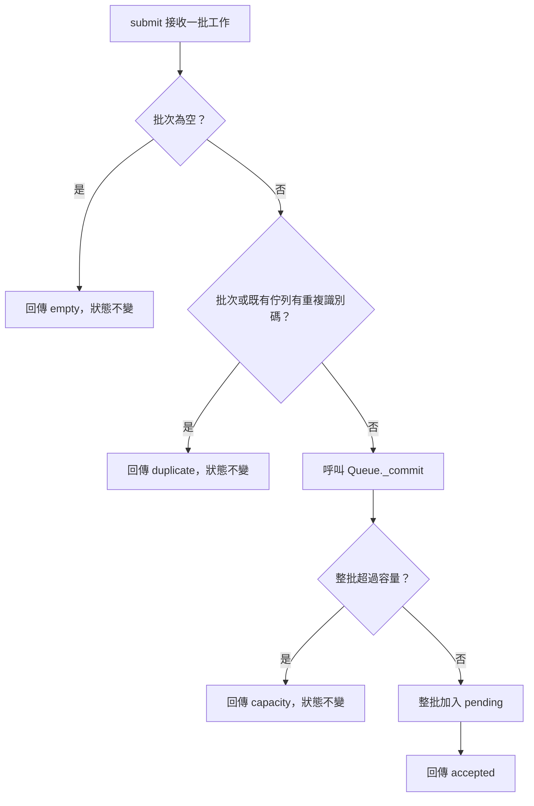

# 帶讀一個有界的佇列操作

這個案例只使用 Python 標準函式庫，狀態留在程序記憶體中。`Queue` 提供可比較的正確行為，`BuggyQueue` 刻意保留部分寫入的缺陷，供 trace 與 RCA 使用；它不是正式工作佇列或併發安全的實作。

從框架根目錄讀取 [queue_walkthrough.py](queue_walkthrough.py)。可直接檢視檔案，也可用共同 CLI 限制擷取量：

```text
python scripts/agf.py context extract examples/learning/queue_walkthrough.py --max-chars 12000
```

本例的輸入限制來自 [教材規格](../research/mini-spec.md)。先讀 `Queue.submit`、`Queue._commit` 與 `observe`，用 `capacity=2`、`pending=["A"]`、`jobs=["B", "C"]` 靜態追蹤一次。依實際 guard 順序說明結果與狀態，不預先執行也能解釋來源支持的路徑。

下列命令以 `python` 為例。Linux/WSL 若只有 `python3`，請替換執行入口；透過 `run` 時，`--` 後的程式名稱也要一起替換。

已授權執行時，可在框架根目錄執行：

```text
python examples/learning/queue_walkthrough.py
```

或透過共同命令保留 timeout 與工作目錄：

```text
python scripts/agf.py run --cwd . --timeout 10 -- python examples/learning/queue_walkthrough.py
```

腳本會依序列出三個觀察情境。下表是由程式推得的**預期值**；只有實際執行後的輸出，才是該次環境的 runtime 觀察。

| 實作／輸入 | 預期回傳 | 預期 `pending` |
|---|---|---|
| `Queue`／`["B"]` | `accepted` | `["A", "B"]` |
| `Queue`／`["B", "C"]` | `capacity` | `["A"]` |
| `BuggyQueue`／`["B", "C"]` | `capacity` | `["A", "B"]` |

## 正常與拒絕路徑

`Queue.submit` 先排除空批次，再排除重複識別碼，最後呼叫 `_commit`。`Queue._commit` 在修改前比較整批需求與剩餘容量；足夠才用 `extend` 接納整批工作。



這張圖描述正確 `Queue` 的同步呼叫與條件分支，來源是這份 Python 程式。它沒有工作執行器、callback、執行緒或裝置通知，不應擴畫成這些機制的 runtime 時序。

## 用同一情境找根因

對 `BuggyQueue`，症狀是回傳 `capacity` 後 `pending` 仍增加。先定位第一次狀態改變：`BuggyQueue._commit` 接納 `B`，到 `C` 才發現容量不足並返回。預期不變條件是「拒絕的批次不改變既有佇列」，缺陷則是修改發生在整批驗證完成之前。

可以比較兩個解釋：回傳值錯了，或狀態確實在拒絕前被改變。觀察回傳及修改前後的完整 `pending`，就能區分。只看 exit code 或一行「capacity」無法發現後者。

修正時應確認容量不足、重複識別碼與空批次都保持原狀，成功時才接納整批且保留順序。本案例不要求再新增一套通用測試框架；若用它練習修正，在獨立練習副本進行，避免消除原本要教的缺陷。

可選的理解練習：`pending=["A"]` 時提交 `["A", "B"]`，為何回傳 `duplicate` 而不是 `capacity`？先解釋 guard 順序，再核對程式。直接帶讀時也可以立即提供答案；不設答題門檻。

到這裡只能說材料、來源及程式行為可以被核對。沒有使用者的實際操作或說明，仍不能宣稱他已理解原子性或具備修 bug 能力。
